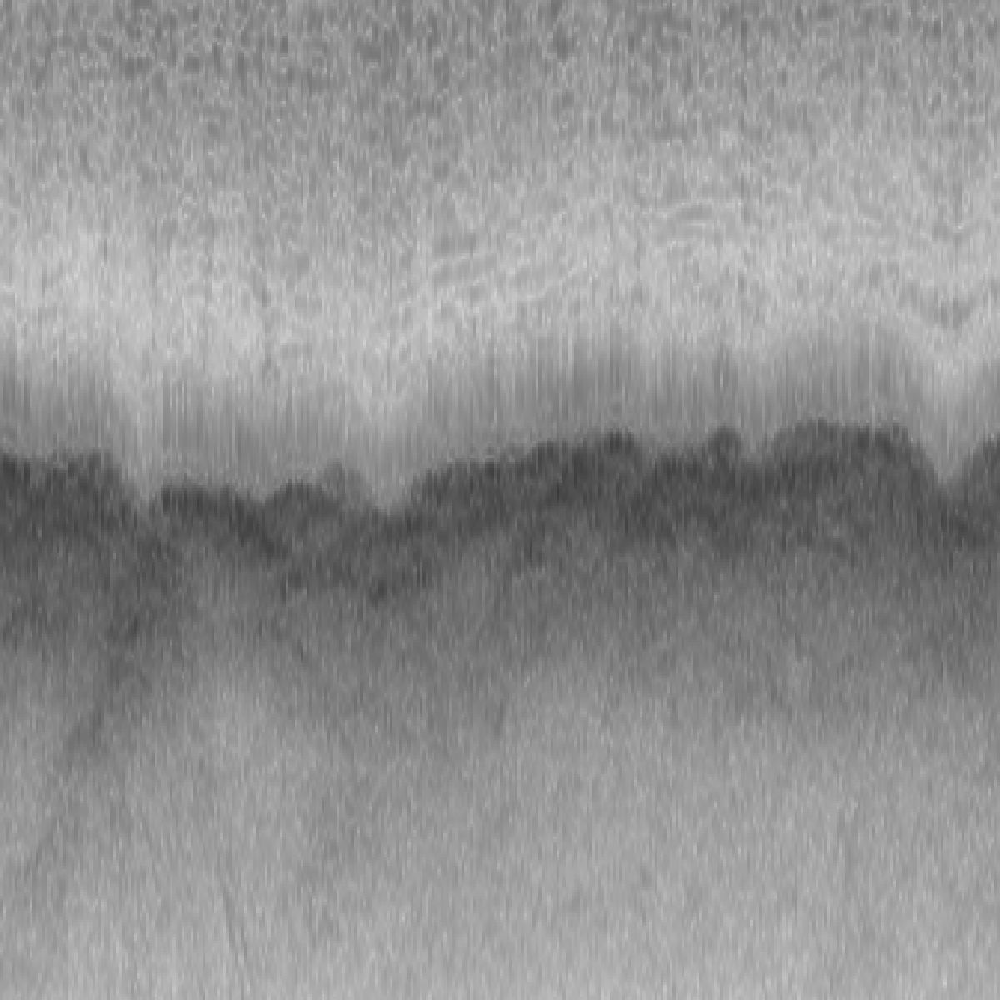
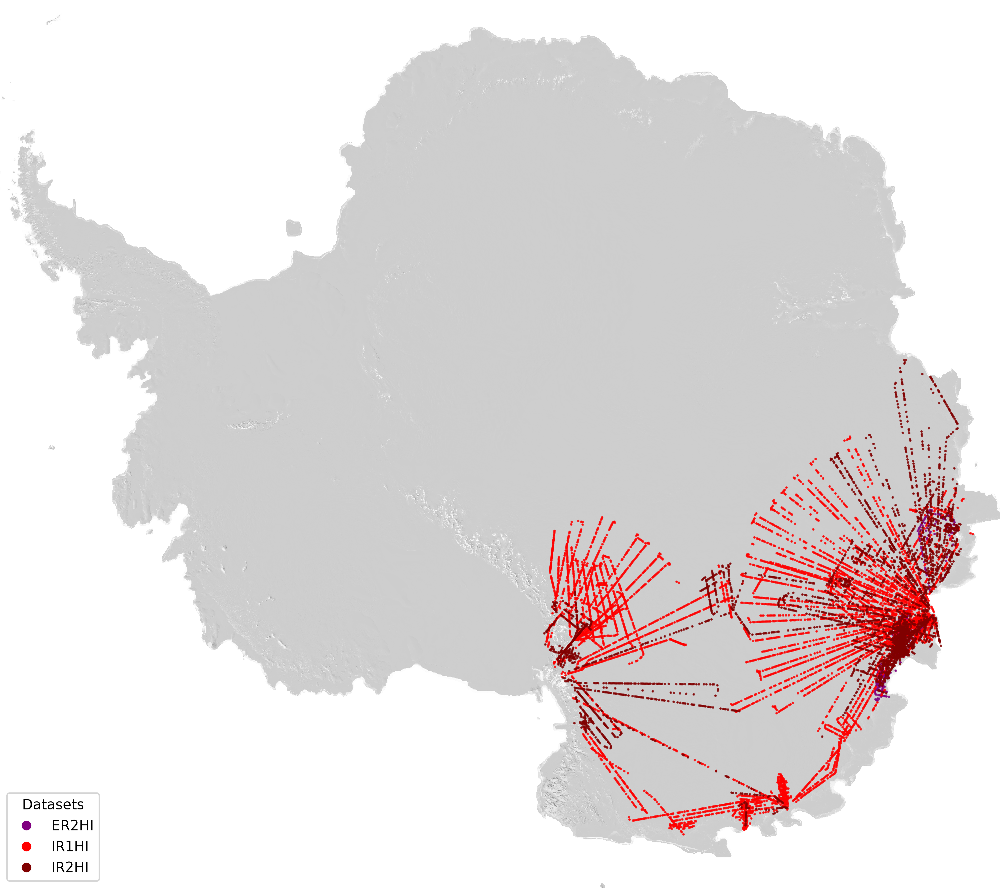

# RadarCLIP

Contrastive learning for ice-penetrating radar (IPR) data.

# Data

We use radargrams from EAGLE and ICECAP covering East Antarctica, combined with their corresponding ice thickness 'picks' to be able to center the radar tiles around the Ice-Bed Interface Zone (IBIZ). 

- [ER2HI1B](https://data.aad.gov.au/metadata/AAS_4346_EAGLE_ICECAP_LEVEL2_RADAR_DATA) (radargrams) and [ER2HI2](https://data.aad.gov.au/metadata/AAS_4346_EAGLE_ICECAP_LEVEL2_AEROGEOPHYSICS) (geolocated ice thickness, bed and surface elevation), accessed via the Australian Antarctic Data Center
    - Short name composition:
        - ER: EAGLE Radar. EAGLE is sometimes referred to as being part of ICECAP II.
        - 2HI: HiCARS2 (Hi-Capability Radar Sounder Version 2)
        - 1B / 2: Level 1B or Level 2 data
    - Seasons: We only use the "2016" subset which covers the 2016/2017 season.
    - ER2HI1B Reference: Blankenship, D.D., Roberts, J.L., Greenbaum, J.S., Young, D.A., Van Ommen, T., Le Meur, E. and Beem, L.H. (2018) EAGLE/ICECAP II RADARGRAMS, Ver. 1, Australian Antarctic Data Centre - doi:10.26179/5bcff4afc287d, Accessed: 2026-10-28
    - ER2HI2 Reference: Roberts, J.L., Blankenship, D.D., Greenbaum, J.S., Beem, L.H., Kempf, S.D., Young, D.A., Richter, T.G., Van Ommen, T. and Le Meur, E. (2018) EAGLE/ICECAP II - geophysical observations (surface and bed elevation, ice thickness, gravity disturbance and magnetic anomalies) - 2015-2018, Ver. 3, Australian Antarctic Data Centre - doi:10.26179/11md-a816, Accessed: 2026-10-28
- [IR1HI1B](https://www.earthdata.nasa.gov/data/catalog/nsidc-cprd-ir1hi1b-1) and [IR1HI2](https://www.earthdata.nasa.gov/data/catalog/nsidc-cprd-ir2hi1b-1), accessed from NASA Earthdata using the python package [earthaccess](https://earthaccess.readthedocs.io/en/stable/)
    - Short name composition:
        - IR: ICECAP Radar
        - 1HI: HiCARS1 (Hi-Capability Radar Sounder Version 1)
        - 1B / 2: Level 1B or Level 2 data
    - Seasons: HiCARS1 was used in 2008, 2009, and 2010
    - IR1HI1B Reference: Blankenship, D. D., Kempf, S. D., Young, D. A., Richter, T. G., Schroeder, D. M., Greenbaum, J. S., van Ommen, T., Warner, R. C., Roberts, J. L., Young, N. W., Lemeur, E., Siegert, M. J. & Holt, J. W. (2017). IceBridge HiCARS 1 L1B Time-Tagged Echo Strength Profiles. (IR1HI1B, Version 1). [Data Set]. Boulder, Colorado USA. NASA National Snow and Ice Data Center Distributed Active Archive Center. https://doi.org/10.5067/W2KXX0MYNJ9G. Date Accessed 11-02-2026.
    - IR1HI2 Reference: Blankenship, D. D., Kempf, S. D., Young, D. A., Richter, T. G., Schroeder, D. M., Greenbaum, J. S., Holt, J. W., van Ommen, T., Warner, R. C., Roberts, J. L., Young, N. W., Lemeur, E. & Siegert, M. J. (2011). IceBridge HiCARS 1 L2 Geolocated Ice Thickness. (IR1HI2, Version 1). [Data Set]. Boulder, Colorado USA. NASA National Snow and Ice Data Center Distributed Active Archive Center. https://doi.org/10.5067/F5FGUT9F5089. Date Accessed 11-02-2026.
- [IR2HI1B](https://www.earthdata.nasa.gov/data/catalog/nsidc-cprd-ir2hi1b-1) and [IR2HI2](https://www.earthdata.nasa.gov/data/catalog/nsidc-cprd-ir2hi1b-1), accessed from NASA Earthdata using the python package [earthaccess](https://earthaccess.readthedocs.io/en/stable/)
    - Short name composition:
        - IR: ICECAP Radar
        - 2HI: HiCARS2 (Hi-Capability Radar Sounder Version 2); the later surveys were flown with Version 2
        - 1B / 2: Level 1B or Level 2 data
    - Seasons: HiCARS2 was used in 2010, 2011, and 2012
    - IR2HI1B Reference: Blankenship, D. D., Kempf, S. D., Young, D. A., Richter, T. G., Schroeder, D. M., Ng, G., Greenbaum, J. S., van Ommen, T., Warner, R. C., Roberts, J. L., Young, N. W., Lemeur, E. & Siegert, M. J. (2017). IceBridge HiCARS 2 L1B Time-Tagged Echo Strength Profiles. (IR2HI1B, Version 1). [Data Set]. Boulder, Colorado USA. NASA National Snow and Ice Data Center Distributed Active Archive Center. https://doi.org/10.5067/0I7PFBVQOGO5. Date Accessed 11-02-2026.
    - IR2HI2 Reference: Blankenship, D. D., Kempf, S. D., Young, D. A., Richter, T. G., Schroeder, D. M., Ng, G., Greenbaum, J. S., van Ommen, T., Warner, R. C., Roberts, J. L., Young, N. W., Lemeur, E. & Siegert, M. J. (2012). IceBridge HiCARS 2 L2 Geolocated Ice Thickness. (IR2HI2, Version 1). [Data Set]. Boulder, Colorado USA. NASA National Snow and Ice Data Center Distributed Active Archive Center. https://doi.org/10.5067/9EBR2T0VXUDG. Date Accessed 11-02-2026.

# Processing notes

# xOPR notes

# Encoders
- DINO v2
- RETFound

# Tasks with embeddings
- subglacial water!
- ice thickness prediction on hold-out data
- basal friction prediction on hold-out data
- of a certain radar phenomenon, try to find similar tiles

# ToDo
- combine three data sets
- plot spread over continent
- channels: one raw, one normalised?, one normalised w.r.t. bed reflection?! mask ice only?!

# Idea beyond this project
- Use pipelines for bed picking automation task (line kilometers)

