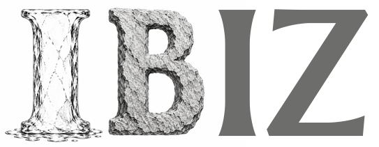

# RadarCLIP

Contrastive learning for ice-penetrating radar (IPR) data.

Other naming ideas: Contrastive Radar Image - Satellite Pretraining (CRISP)

# Data

We use radargrams from EAGLE and ICECAP covering East Antarctica, combined with their corresponding ice thickness 'picks' to be able to center the radar tiles around the Ice-Bed Interface Zone (IBIZ). 

- [ER2HI1B](https://data.aad.gov.au/metadata/AAS_4346_EAGLE_ICECAP_LEVEL2_RADAR_DATA) (radargrams) and [ER2HI2](https://data.aad.gov.au/metadata/AAS_4346_EAGLE_ICECAP_LEVEL2_AEROGEOPHYSICS) (geolocated ice thickness, bed and surface elevation), accessed via the Australian Antarctic Data Center
    - Short name composition:
        - ER: EAGLE Radar. EAGLE is sometimes referred to as being part of ICECAP II.
        - 2HI: HiCARS2 (Hi-Capability Radar Sounder Version 2)
        - 1B / 2: Level 1B or Level 2 data
    - Seasons: We only use the "2016" subset which covers the 2016/2017 season.
    - ER2HI1B Reference: Blankenship, D.D., Roberts, J.L., Greenbaum, J.S., Young, D.A., Van Ommen, T., Le Meur, E. and Beem, L.H. (2018) EAGLE/ICECAP II RADARGRAMS, Ver. 1, Australian Antarctic Data Centre - doi:10.26179/5bcff4afc287d, Accessed: 2026-10-28
    - ER2HI2 Reference: Roberts, J.L., Blankenship, D.D., Greenbaum, J.S., Beem, L.H., Kempf, S.D., Young, D.A., Richter, T.G., Van Ommen, T. and Le Meur, E. (2018) EAGLE/ICECAP II - geophysical observations (surface and bed elevation, ice thickness, gravity disturbance and magnetic anomalies) - 2015-2018, Ver. 3, Australian Antarctic Data Centre - doi:10.26179/11md-a816, Accessed: 2026-10-28
- [IR1HI1B](https://www.earthdata.nasa.gov/data/catalog/nsidc-cprd-ir1hi1b-1) and [IR1HI2](https://www.earthdata.nasa.gov/data/catalog/nsidc-cprd-ir2hi1b-1), accessed from NASA Earthdata using the python package [earthaccess](https://earthaccess.readthedocs.io/en/stable/)
    - Short name composition:
        - IR: ICECAP Radar
        - 1HI: HiCARS1 (Hi-Capability Radar Sounder Version 1)
        - 1B / 2: Level 1B or Level 2 data
    - Seasons: HiCARS1 was used in 2008, 2009, and 2010
    - IR1HI1B Reference:
    - IR1HI1B Reference: 
- [IR2HI1B](https://www.earthdata.nasa.gov/data/catalog/nsidc-cprd-ir2hi1b-1) and [IR2HI2](https://www.earthdata.nasa.gov/data/catalog/nsidc-cprd-ir2hi1b-1), accessed from NASA Earthdata using the python package [earthaccess](https://earthaccess.readthedocs.io/en/stable/)
    - Short name composition:
        - IR: ICECAP Radar
        - 2HI: HiCARS2 (Hi-Capability Radar Sounder Version 2); the later surveys were flown with Version 2
        - 1B / 2: Level 1B or Level 2 data
    - Seasons: HiCARS2 was used in 2010, 2011, and 2012
    - IR2HI1B Reference: Blankenship, D., Kempf, S., Young, D., Richter, T., Schroeder, D., Ng, G., Greenbaum, J., van Ommen, T., Warner, R., Roberts, J., Young, N., Lemeur, E., & Siegert, M. (2017). IceBridge HiCARS 2 L1B Time-Tagged Echo Strength Profiles, Version 1 [Dataset]. NASA National Snow and Ice Data Center Distributed Active Archive Center. https://doi.org/10.5067/0I7PFBVQOGO5 Date Accessed: 2026-10-26
    - IR2HI2 Reference: 

## EAGLE (ER2HI__) processing 
- datatypes of lon lat are mismatched between 1B and 2. (L1B: float32; L2: .txt file with 6 decimals reported) 

# Questions for radioglaciology experts
- How is the offset on top determined and what value is used during preprocessing? (L1B -> L2)
- Is the "ice surface" the surface of the lower, compacted ice or the surface of the firn (surface pick coincides with strongest signal but not upper signal)
- low gain/ high gain

# Known issues
2016: 156 radargrams
ER2HI1B_2017023_ICP8_JKB2r_F07T08a_000 (no match at all)
ER2HI1B_2017027_KNX_JKB2r_Y27a_001 (one missing)

# Environment

# Vocabulary
- subtrate
- trace

# xOPR
- some of the UTIG data does not contain bed picks (which I need)

# Normalisation
- Potentially only shift the data to be mean zero to keep relative differences in db inside the data, while decoupling from ice thickness/attenuation
- 
- 

# HiCARS Earthdata

https://gitlab.com/openpolarradar/opr/-/wikis/Processing-Notes

# Contrast
- deformation velocity
- Calculate the driving stress
- τ_d = ρ · g · H · tan(α)
- u_surface = u_deformation + u_basal
- https://agupubs.onlinelibrary.wiley.com/doi/full/10.1002/jgrf.20125 
- https://agupubs.onlinelibrary.wiley.com/doi/full/10.1002/2014GL059976

ML:
- Rank-N-contrast

## Questions:
- What code does xOPR use to determine bed picks? 
- Assign IDs to tiles? 
- Spacing? 
- What additional data do I need? (Specularity)

# Encoding: 

Pre-trained computer vision encoder maps an image to an embedding (fixed-length vector).
(SeisCLIP)
OCT (optical coherence tomography)
RETFound

DINOv2 (224 or 364)

# Variables:
Calculate from radar tile:
- average amplitude in "above boundry" layer
- specularity?!

# ToDo
- add additional values to meta data:
    - specularity
    - roughness
- Mask out "above bed" and "below bed" and for instance calculate metrics such as variability?!